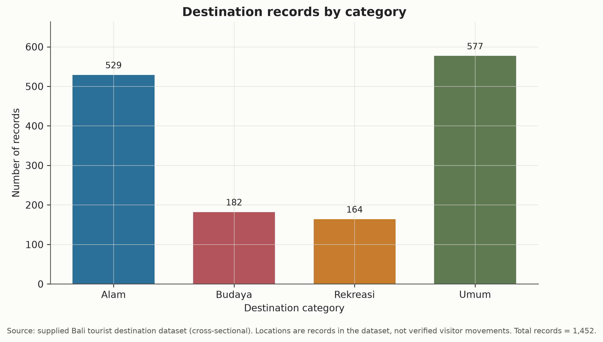
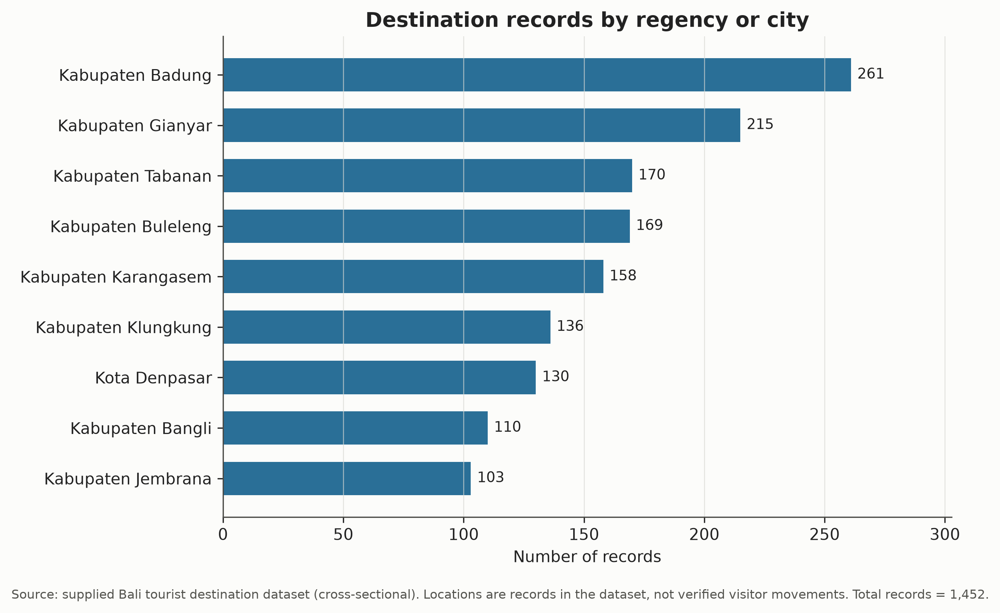
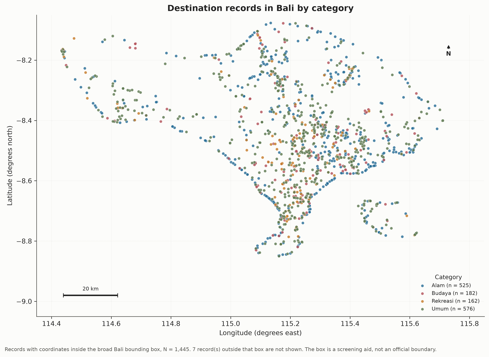
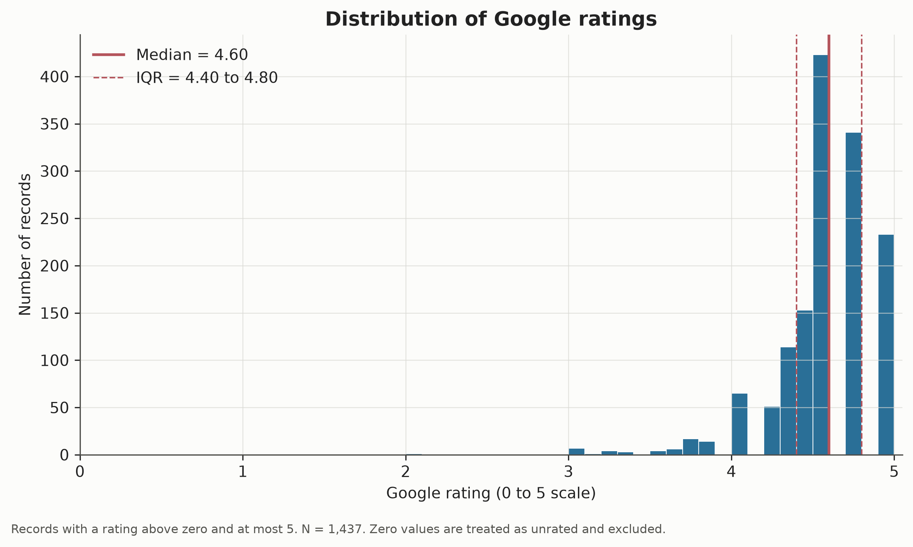
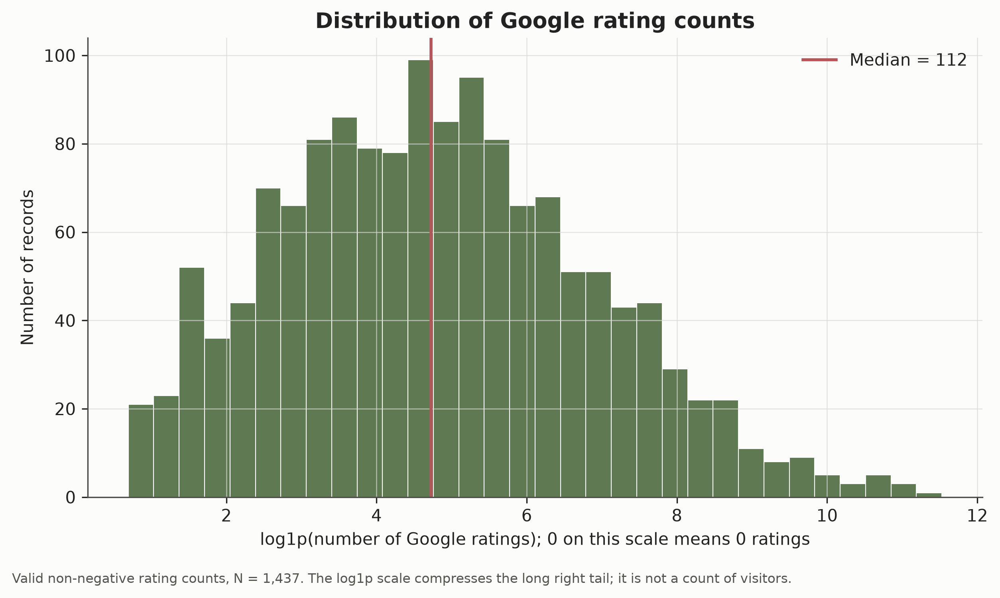
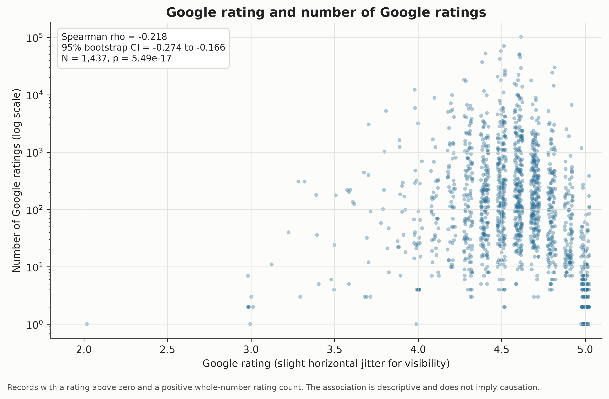
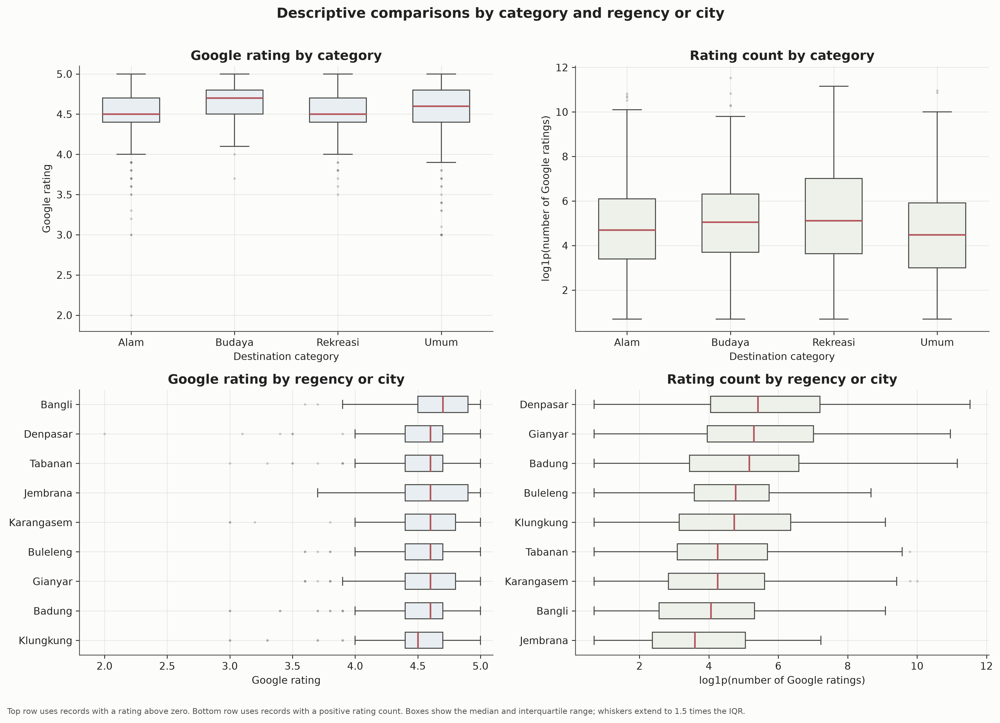
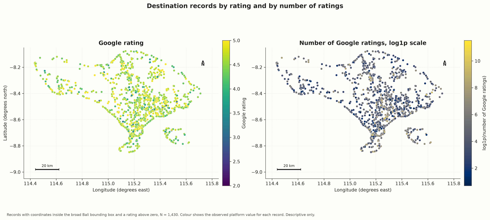

# Spatial Patterns and the Rating-Popularity Relationship of Tourist Destinations in Bali

Generated: 2026-10-27 07:05 UTC  
Input file: `/home/dhanu/Downloads/bali_tourism_geospatial_project_docs/bali_tourism_geospatial_project/data/raw/bali_tourist_destination.csv`  
SHA-256: `68f4ae5a8cb5f90ebf5f11c8263a8b33c2a425c85df66c936050e28e9cb4237d`  
Source records: 1,452 rows and 11 columns.

## 1. Purpose and scope

This report describes the supplied cross-sectional dataset of tourist destinations in Bali. It covers data quality, the geographic distribution of records, the distributions of Google ratings and Google rating counts, and the rank association between those two variables. The rating count is treated as a measure of online review engagement, not as visitor volume. All findings describe the supplied records and do not establish causal effects or population-wide coverage.

## 2. Data and methods

The source CSV was read as text, inspected against the expected schema, and retained unchanged. Numeric fields were converted with explicit failure tracking. Ratings equal to zero were treated as unrated records rather than as literal scores of zero. Coordinates were checked against global ranges and a broad Bali bounding box used only for screening. No records were removed on the basis of matching names. Separate analytic samples were defined for mapping, rating summaries, and the rating-count association.

The primary association measure is Spearman's rank correlation, with a percentile bootstrap confidence interval. Category and regency comparisons use Kruskal-Wallis tests with Dunn post-hoc comparisons and Holm adjustment. Spatial autocorrelation, when reported, uses global Moran's I with row-standardised k-nearest-neighbour weights built in projected metres (UTM zone 50S) and permutation inference.

## 3. Data audit and cleaning

- Exact duplicate rows: 0
- Repeated destination IDs: 0
- Repeated destination names, exact matches after the first occurrence: 15
- Rows in case-insensitive name groups: 34
- Records with a rating recorded as zero: 15
- Records outside the broad Bali bounding box: 7
- Records sharing coordinates with another record: 24
- Records matching another record on name, coordinates, rating, and count: 4
- Missing image links: 4

All expected columns were present.

### Cleaning log

| step | rule | rows_flagged | rows_excluded | note |
|---|---|---|---|---|
| Audit | Rows in source file | 1452 | 0 | Raw file is preserved unchanged. |
| Cleaning | Leading or trailing whitespace trimmed in text fields | 0 | 0 | Only surrounding whitespace was removed. |
| Cleaning | Numeric fields that could not be parsed | 0 | 0 | Unparseable values are retained in the audit output. |
| Flagging | Rating recorded as zero | 15 | 15 | A zero is treated as an unrated record, not as a literal quality score. |
| Flagging | Rating outside 0 to 5 | 0 | 0 |  |
| Flagging | Missing rating | 0 | 0 |  |
| Flagging | Missing rating count | 0 | 0 |  |
| Flagging | Negative rating count | 0 | 0 |  |
| Flagging | Fractional rating count | 0 | 0 |  |
| Flagging | Rating count recorded as zero | 15 | 0 | Retained in the data but excluded from the rating-count association. |
| Flagging | Missing coordinates | 0 | 0 |  |
| Flagging | Coordinates invalid at global scale | 0 | 0 |  |
| Flagging | Coordinates outside the broad Bali bounding box | 7 | 7 | Excluded only from geographic mapping and spatial analysis. |
| Flagging | Rows sharing a coordinate with at least one other record | 24 | 0 | Retained; sensitivity analysis aggregates coincident locations. |
| Flagging | Rows whose name is repeated after case and whitespace normalisation | 34 | 0 | Names alone are not treated as evidence of duplication. |
| Flagging | Rows matching another record on name, coordinates, rating, and count | 4 | 0 | Exported for review; retained in the primary analysis. |
| Flagging | Missing image link | 4 | 0 |  |
| Sample | Eligible for geographic mapping | 1445 | 7 | Requires non-missing coordinates inside the broad Bali bounding box. |
| Sample | Eligible for rating summaries and rating-count association | 1437 | 15 | Requires a rating above zero, at most 5, and a positive whole-number rating count. |

Repeated names and matching records were exported for manual review. They were retained in the primary analysis and addressed in the robustness checks rather than deleted automatically.

## 4. Geographic distribution

Records are available for 4 categories and 9 regencies or cities. The geographic mapping sample contains 1,445 records with coordinates inside the broad Bali bounding box.

### Records by category

| kategori | records |
|---|---|
| Alam | 529 |
| Budaya | 182 |
| Rekreasi | 164 |
| Umum | 577 |

### Records by regency or city

| kabupaten_kota | records |
|---|---|
| Kabupaten Badung | 261 |
| Kabupaten Gianyar | 215 |
| Kabupaten Tabanan | 170 |
| Kabupaten Buleleng | 169 |
| Kabupaten Karangasem | 158 |
| Kabupaten Klungkung | 136 |
| Kota Denpasar | 130 |
| Kabupaten Bangli | 110 |
| Kabupaten Jembrana | 103 |

The category and regency tables above use all source records. A comparison restricted to records with coordinates inside the broad Bali bounding box is shown below; it is the sample used in the maps.

### Records by regency or city, valid-coordinate subset

| kabupaten_kota | records |
|---|---|
| Kabupaten Badung | 261 |
| Kabupaten Gianyar | 215 |
| Kabupaten Buleleng | 169 |
| Kabupaten Tabanan | 163 |
| Kabupaten Karangasem | 158 |
| Kabupaten Klungkung | 136 |
| Kota Denpasar | 130 |
| Kabupaten Bangli | 110 |
| Kabupaten Jembrana | 103 |

The point map is descriptive. Dense areas reflect the geographic distribution of records in this dataset, not verified tourist flows or a statistically tested hotspot pattern.

## 5. Rating and rating-count distributions

Among 1,437 records with a rating above zero, the median rating was 4.60 with an interquartile range of 4.40 to 4.80. The mean was 4.55 (SD 0.32).

Among the same eligible association sample, the median number of Google ratings was 112 with an interquartile range of 25 to 477. The distribution is strongly right-skewed, so the median and logarithmic displays are more informative than the mean alone.

## 6. Rating-popularity association

Across N = 1,437 records with a rating above zero and a positive whole-number rating count, the Spearman rank correlation was rho = -0.218 (95% percentile bootstrap CI -0.274 to -0.166; p = 5.49e-17).

The observed association is negative and weak in magnitude. This describes the supplied records only. It does not show that high ratings cause more reviews, or that review counts measure visitor demand.

As a secondary check, the Pearson correlation between the raw variables was r = -0.020 (N = 1,437). It is reported only for comparison because the count variable is strongly skewed and the rating variable has many ties. The near-zero Pearson value and the modest negative Spearman value are not contradictory: Pearson uses the raw count scale, where a few very large counts dominate, while Spearman uses ranks.

## 7. Category and regional comparisons

- Google rating by category: Kruskal-Wallis H = 32.808, p = 3.53e-07, epsilon-squared = 0.021, N = 1,437, groups = 4.
- Google rating by regency or city: Kruskal-Wallis H = 34.845, p = 2.85e-05, epsilon-squared = 0.019, N = 1,437, groups = 9.
- Rating count by category: Kruskal-Wallis H = 20.828, p = 0.000114, epsilon-squared = 0.012, N = 1,437, groups = 4.
- Rating count by regency or city: Kruskal-Wallis H = 87.758, p = 1.33e-15, epsilon-squared = 0.056, N = 1,437, groups = 9.

These tests describe differences in the supplied records. They do not control for differences in category composition, destination visibility, or data collection coverage. Effect sizes are modest in some cases, so statistical significance should not be read as practical importance.

27 pairwise Dunn comparison(s) remained significant after Holm adjustment. The full table is exported with the analysis outputs.

## 8. Spatial autocorrelation

Global Moran's I was estimated for log1p(number of Google ratings) using row-standardised k-nearest-neighbour weights with k = 8, N = 1,430, and 999 permutations. The observed statistic was I = 0.118, expected I = -0.001, with a one-sided permutation p-value of 0.001.

For Google rating, the corresponding statistic was I = 0.059 with a one-sided permutation p-value of 0.001.

With 999 permutations, 0.001 is the smallest attainable one-sided p-value. The result should be read as evidence against spatial randomness, not as a precise p-value.

Global Moran's I tests whether nearby values are more similar than expected under spatial randomness. It is not a local hotspot analysis. The k-nearest-neighbour design links each record to nearby records regardless of coastlines or administrative boundaries, and it is sensitive to the choice of k. At k = 8 the weights formed 2 connected component(s); the Nusa Penida and Lembongan records form a group that is not linked to the mainland at this setting.

| variable | k | n | morans_i | expected_i | p_perm_greater | p_perm_two_sided | permutations | components | min_neighbours | max_neighbours |
|---|---|---|---|---|---|---|---|---|---|---|
| rating | 4 | 1430 | 0.08198 | -0.0006998 | 0.001 | 0.001 | 999 | 6 | 4 | 4 |
| rating | 8 | 1430 | 0.0589 | -0.0006998 | 0.001 | 0.001 | 999 | 2 | 8 | 8 |
| rating | 12 | 1430 | 0.05019 | -0.0006998 | 0.001 | 0.001 | 999 | 2 | 12 | 12 |
| log_jumlah_rating | 4 | 1430 | 0.1264 | -0.0006998 | 0.001 | 0.001 | 999 | 6 | 4 | 4 |
| log_jumlah_rating | 8 | 1430 | 0.1179 | -0.0006998 | 0.001 | 0.001 | 999 | 2 | 8 | 8 |
| log_jumlah_rating | 12 | 1430 | 0.1053 | -0.0006998 | 0.001 | 0.001 | 999 | 2 | 12 | 12 |

A sensitivity analysis averaged the outcome within each exact coordinate. Results for that coordinate-level sample are exported in `outputs/tables/spatial_autocorrelation_aggregated.csv`.

A further sensitivity restricted to the largest connected component (N = 1,367, k = 8) gave I = 0.119 with a one-sided permutation p-value of 0.001.

## 9. Robustness checks

| specification | n | rho | p_value | direction |
|---|---|---|---|---|
| Primary: rating above 0 and positive count | 1437 | -0.2185 | 5.488e-17 | negative |
| Include zero ratings and zero counts as observed values | 1452 | -0.1809 | 3.845e-12 | negative |
| Exclude all records flagged as likely duplicates | 1433 | -0.219 | 5.096e-17 | negative |
| Deduplicate matching records, keep first | 1435 | -0.2187 | 5.291e-17 | negative |
| Exclude records sharing a coordinate | 1414 | -0.2147 | 3.27e-16 | negative |
| Restrict to records inside the Bali bounding box | 1430 | -0.2165 | 1.258e-16 | negative |
| Restrict to ratings of 4 or above | 1380 | -0.2724 | 6.618e-25 | negative |

Robustness specifications are descriptive comparisons of the same association under alternative eligibility rules. They are not separate hypothesis tests and should not be overinterpreted.

## 10. Limitations

- The dataset is cross-sectional and has no verified extraction date in the supplied file, so no temporal claims are made.
- The rating count is the number of Google ratings or reviews, not the number of visitors, arrivals, or spending.
- Ratings are platform scores and may reflect rounding, ceiling effects, and platform-specific review behaviour.
- The dataset does not provide a validated sampling frame, so it cannot be assumed to represent every destination in Bali.
- Seven records have coordinates that fall outside the broad Bali bounding box and are excluded only from mapping and spatial analysis.
- Zero ratings and zero rating counts are treated as unrated records; they are retained in the processed data and flagged.
- Repeated names and matching records are retained in the primary analysis because names alone are not proof of duplication.
- Coordinates inside the broad bounding box were not validated against official regency boundaries; some records may have plausible coordinates with inconsistent region labels.
- The maps use a longitude and latitude display with an aspect correction and a broad screening box, not an official administrative boundary layer.
- Global Moran's I depends on the spatial weights specification and on uneven sampling density; it does not identify local hotspots.
- Group comparisons are unadjusted for category composition, access, promotion, destination age, or other unobserved factors.

## 11. Reproducibility

The analysis is implemented in `notebooks/01_exploratory_geospatial_analysis.ipynb` with helper modules in `src/`. Random procedures use a fixed seed. The raw CSV is preserved unchanged in `data/raw/`, and the analysis-ready table with all flags and derived fields is written to `data/processed/analysis_ready.csv`.

Key outputs:

- `data/processed/analysis_ready.csv`
- `data/processed/coincident_coordinate_records.csv`
- `data/processed/flagged_coordinate_records.csv`
- `data/processed/invalid_numeric_records.csv`
- `data/processed/likely_duplicate_records.csv`
- `data/processed/name_duplicate_candidates.csv`
- `outputs/figures/01_category_counts.png`
- `outputs/figures/02_regency_counts.png`
- `outputs/figures/03_rating_distribution.png`
- `outputs/figures/04_rating_count_distribution.png`
- `outputs/figures/05_rating_vs_count.png`
- `outputs/figures/06_group_distributions.png`
- `outputs/figures/07_map_destinations.png`
- `outputs/figures/08_map_attributes.png`
- `outputs/reports/analysis_report.md`
- `outputs/tables/category_counts.csv`
- `outputs/tables/category_counts_valid_coordinates.csv`
- `outputs/tables/cleaning_log.csv`
- `outputs/tables/coordinate_review.csv`
- `outputs/tables/dataset_audit_summary.csv`
- `outputs/tables/descriptive_summary.csv`
- `outputs/tables/duplicate_summary.csv`
- `outputs/tables/environment_versions.csv`
- `outputs/tables/group_comparisons.csv`
- `outputs/tables/group_comparisons_posthoc.csv`
- `outputs/tables/missingness.csv`
- `outputs/tables/rating_by_category.csv`
- `outputs/tables/rating_by_regency.csv`
- `outputs/tables/rating_count_by_category.csv`
- `outputs/tables/rating_count_by_regency.csv`
- `outputs/tables/rating_popularity_alternatives.csv`
- `outputs/tables/rating_popularity_association.csv`
- `outputs/tables/regency_counts.csv`
- `outputs/tables/regency_counts_comparison.csv`
- `outputs/tables/regency_counts_valid_coordinates.csv`
- `outputs/tables/robustness_spearman.csv`
- `outputs/tables/schema_audit.csv`
- `outputs/tables/spatial_autocorrelation.csv`
- `outputs/tables/spatial_autocorrelation_aggregated.csv`
- `outputs/tables/spatial_autocorrelation_largest_component.csv`
- `outputs/tables/spatial_feasibility.csv`
- `outputs/tables/subdistrict_counts.csv`
- `outputs/tables/subdistrict_counts_valid_coordinates.csv`

Dependency versions are recorded in `requirements.txt` and in `outputs/tables/environment_versions.csv`.
